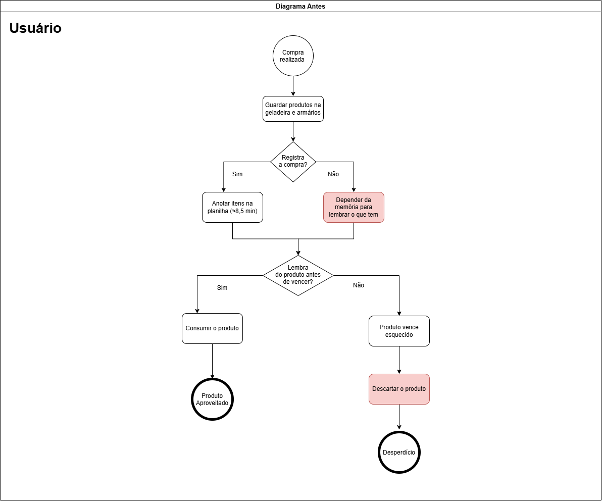
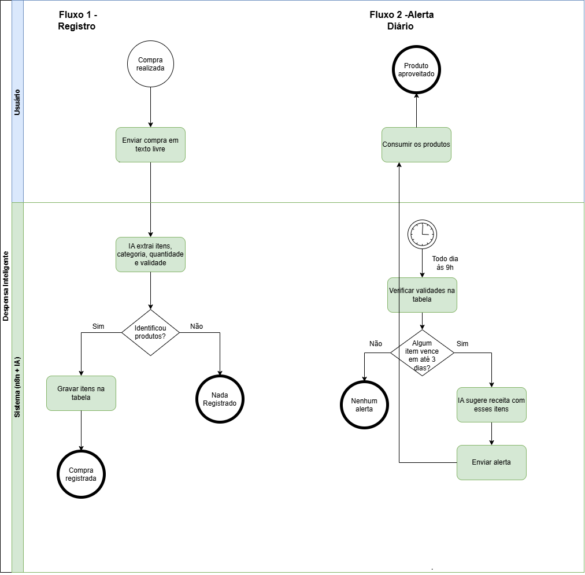
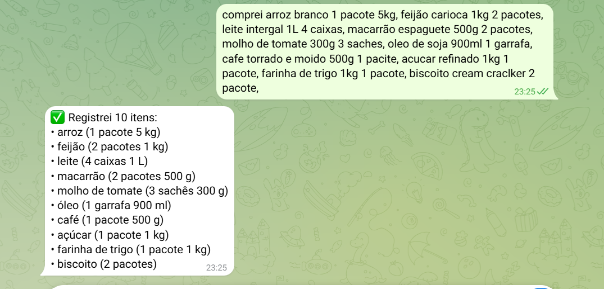
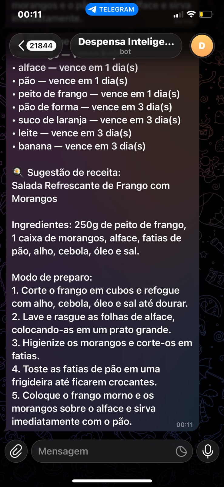

# Despensa Inteligente

Bot no Telegram que registra compras de supermercado escritas em texto livre, avisa todo dia o que está perto de vencer e sugere uma receita com esses itens. Construído com **n8n** e **IA generativa (Google Gemini)**.

> Reduziu o registro de uma compra de **8min34s para 2min38s (−69%)**, com **94% dos itens corretos** e categorias padronizadas de **24 para 7** (medição com 5 compras de 10 itens).


---

## O problema

Quem mora sozinho raramente registra o que compra e depende da memória para lembrar o que tem em casa. O resultado:

- **Registrar dá trabalho.** Anotar uma compra de 10 itens numa planilha leva cerca de 8 minutos e meio, então quase ninguém faz.
- **Produtos vencem esquecidos** no fundo da geladeira ou entre potes de outras refeições.
- **Na hora de cozinhar, falta ideia:** a pessoa acaba pedindo delivery ou repetindo as mesmas refeições, enquanto o que está para vencer fica parado.

## A solução

Dois fluxos no n8n que compartilham uma tabela:

| Fluxo | Gatilho | O que faz |
|---|---|---|
| **1. Registro** | Mensagem no Telegram | A IA extrai cada produto (nome, categoria, quantidade e validade estimada) do texto livre, grava na tabela e confirma no chat |
| **2. Alerta diário** | Todo dia às 9h | Calcula o vencimento de cada item, lista o que vence em até 3 dias e pede à IA uma receita que aproveite esses itens |

Exemplo de uso:

> **Eu:** comprei 2 iogurtes, um pão de forma, alface e 500g de peito de frango
> **Bot:** ✅ Registrei 4 itens: iogurte (2), pão de forma (1), alface (1), peito de frango (500 g)

| Antes | Depois |
|---|---|
|  |  |

### Prints

| Registro no Telegram | Alerta com receita | Dashboard |
|---|---|---|
|  |  |  |

🎥 **Vídeo de demonstração (2 min):** [link](https://youtu.be/3LH_QsKQL7I )

---

## Como funciona

**Fluxo 1, registro** (`workflows/despensa-telegram.json`)

`Telegram Trigger` → `Data table (nomes já cadastrados)` → `Aggregate` → `Basic LLM Chain + Gemini + Structured Output Parser` → `If (encontrou produtos?)` → `Split Out` → `Data table (insert)` → `Telegram (confirmação)`

- **Saída estruturada:** a IA responde obrigatoriamente em JSON com uma lista `itens`, para o fluxo conseguir gravar os dados.
- **Contexto da despensa:** antes de extrair, o fluxo envia à IA os nomes que já existem na tabela, para ela reutilizar o mesmo nome quando for o mesmo produto.
- **Temperatura 0.2:** extração previsível, sem criatividade.
- **Restrito ao meu chat:** o bot só processa mensagens do meu usuário.

**Fluxo 2, alerta diário** (`workflows/despensa-alerta.json`)

`Schedule Trigger (9h)` → `Data table (todos os itens)` → `Code (calcula vencimento e filtra até 3 dias)` → `Aggregate` → `Basic LLM Chain + Gemini (temperatura 0.7)` → `Telegram`

- **Vencimento** = data do registro + validade estimada. O cálculo é em JavaScript, com as horas zeradas e o fuso de Brasília.
- **Sem repetição:** se o mesmo produto veio em compras diferentes, aparece uma vez só, com o vencimento mais próximo.
- **Receita em texto livre e temperatura mais alta:** quem lê é uma pessoa, e a variedade é desejável.

**Dashboard** (`dashboard/despensa.pbix` e [`dashboard/despensa.pdf`](dashboard/despensa.pdf)): Power BI com total de itens, itens vencendo em até 3 dias e vencidos, número de categorias, próximos vencimentos, itens por categoria e itens por status. Os dados são exportados do n8n por um terceiro workflow (`workflows/despensa-exportar-csv.json`).

---

## Resultados

Mesmas 5 compras de 10 itens registradas à mão numa planilha e pelo bot. Detalhes do método em [`medicoes.md`](medicoes.md).

| Compra | Manual | Bot | Redução |
|---|---|---|---|
| 1 | 8min30s | 3min05s | 64% |
| 2 | 9min00s | 2min27s | 73% |
| 3 | 8min00s | 2min06s | 74% |
| 4 | 7min20s | 2min55s | 60% |
| 5 | 10min00s | 2min35s | 74% |
| **Média** | **8min34s** | **2min38s** | **69%** |

- **Itens corretos:** 47 de 50 (94%). Erros de digitação como "intergal", "cabola 1jg" e "detrgente" foram interpretados corretamente.
- **Categorias:** no cadastro manual, 50 produtos geraram 24 categorias sobrepostas ("Laticínios", "Frios e laticínios", "Laticínios e bebidas"...). Com a IA e uma lista fechada no prompt, ficaram 7.
- **Os 3 erros** foram todos de validade de carne crua superestimada (frango 5 dias, carne moída 3, tilápia 3; o seguro é cerca de 1 a 2). Depois da medição, corrigi o prompt; ver abaixo. A tabela de exemplo e o dashboard mostram os dados da medição, registrados antes dessa correção.

---

## Prompt engineering: o que testei e corrigi

| Problema encontrado | Ajuste no prompt | Resultado |
|---|---|---|
| Categorias inconsistentes | Lista fechada de 8 categorias | 7 categorias padronizadas em 50 produtos |
| Quantidades misturadas ("um", "1", "um pacote") | Exigir número em algarismos + unidade | "1 pacote", "500 g", "6 unidades" |
| Mesmo produto com nomes diferentes | Enviar à IA os nomes já cadastrados + regra de nome genérico (mantendo o tipo quando muda a validade) | "iogurte natural" vira "iogurte"; "pão de forma" e "pão francês" continuam separados |
| Receita vinha com asteriscos de markdown no Telegram | Pedir texto simples, sem formatação | Mensagem limpa no celular |
| Validade de carnes cruas superestimada (frango: 5 dias) | Limite de 2 dias para carnes cruas refrigeradas e regra para "congelado" | Frango 5 → 2 dias; carne moída 3 → 2 dias; tilápia congelada: 90 dias |

Outros casos testados:

- `"oi, tudo bem?"` → lista vazia, nada gravado, e o bot explica como mandar uma compra.
- Áudio → o bot responde que não identificou produtos (não há transcrição).
- Texto bagunçado (`"pao, 3 banana, um leitinho e aquele queijo q eu gosto"`) → pão, banana (3), leite e queijo.

---

## Limitações conhecidas

- **A validade é estimada pela IA,** não lida da embalagem. É orientativa, e foi justamente onde apareceram os erros da medição.
- **O sistema não sabe o que já foi consumido.** Um item comido continua na tabela e pode aparecer no alerta. *Melhoria:* um botão "já consumi" na mensagem do Telegram.
- **O nome genérico perde detalhe.** "Biscoito cream cracker" e "biscoito maisena" viram ambos "biscoito".
- **Só texto.** Áudio e foto não são processados. *Melhoria:* ler a foto da nota fiscal.
- **Roda no meu computador.** Precisa do n8n ligado e de um túnel (cloudflared) cujo endereço muda a cada reinício. *Em produção:* n8n num servidor com domínio fixo.
- **A lista de nomes enviada à IA cresce com a despensa.** Para muitos produtos, o ideal seria enviar só os nomes parecidos com os da mensagem.

---

## Tecnologias

n8n (self-hosted via Node.js) · Google Gemini (API) · Telegram Bot API · n8n Data Tables · JavaScript (nó Code) · cloudflared · Power BI · BPMN (draw.io)

## Como rodar

1. Instale o Node.js 24 (o n8n suporta de 20.19 a 24.x) e o cloudflared.
2. Janela 1: `cloudflared tunnel --url http://localhost:5678` e copie o endereço `https://...trycloudflare.com`.
3. Janela 2:
   ```powershell
   $env:GENERIC_TIMEZONE="America/Sao_Paulo"
   $env:WEBHOOK_URL="https://SEU-ENDERECO.trycloudflare.com/"
   npx n8n
   ```
4. Em http://localhost:5678, importe os arquivos de `workflows/`, crie a tabela `despensa` (`item`, `categoria`, `quantidade` como texto; `validade_estimada_dias` como número) e as credenciais do Telegram (token do @BotFather) e do Gemini (chave do Google AI Studio).
5. No Telegram Trigger, troque o chat ID pelo seu e publique os workflows.

> As chaves ficam nas credenciais do n8n e **não** estão nos arquivos deste repositório.

## Estrutura do repositório

```
despensa-inteligente/
├── README.md
├── problema.md          # dores que o projeto resolve
├── medicoes.md          # método e resultados da medição
├── workflows/           # fluxos exportados do n8n (.json)
├── dashboard/           # despensa.pbix, despensa.pdf, dashboard.png
├── dados/               # despensa.csv (dados de exemplo)
└── docs/img/            # BPMN e prints
```

## O que aprendi

Aprendi que a IA deve ser usada como ferramenta de apoio, não como certeza absoluta. Na medição, ela acertou 94% dos itens, mas superestimou a validade de carnes cruas — um erro que só apareceu porque eu conferi item por item. Também aprendi que o resultado depende muito de como eu peço: listar as categorias permitidas, exigir quantidades em algarismos e dizer o que fazer quando ela não sabe transformou respostas inconsistentes em dados confiáveis. E aprendi a testar com casos difíceis e dados reais, porque foi assim que encontrei problemas que os testes simples não mostravam.

---

Feito por **Maria Morena da Silva Couto**, estudante de Análise e Desenvolvimento de Sistemas (CEUB). [LinkedIn](https://www.linkedin.com/in/maria-morena-da-silva-couto-29a972357/)
